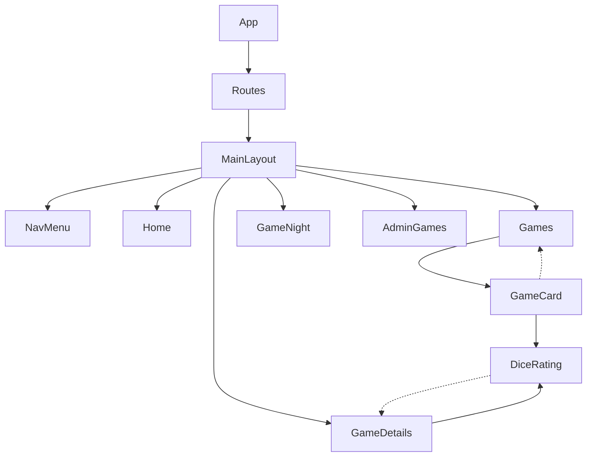
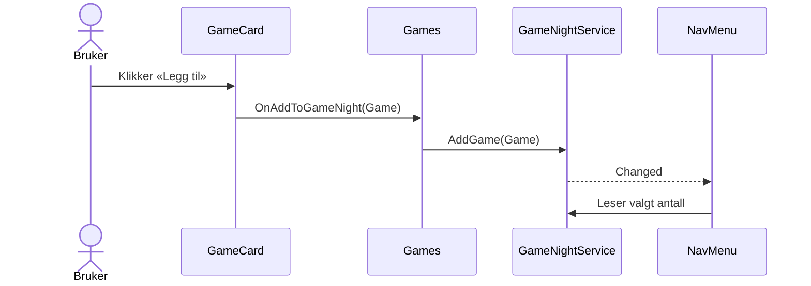
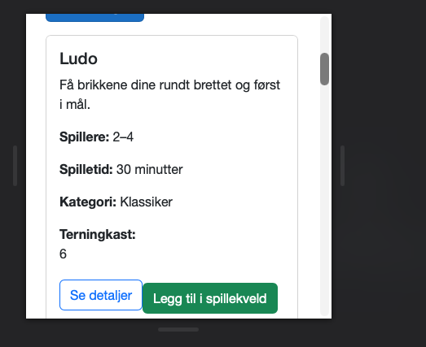
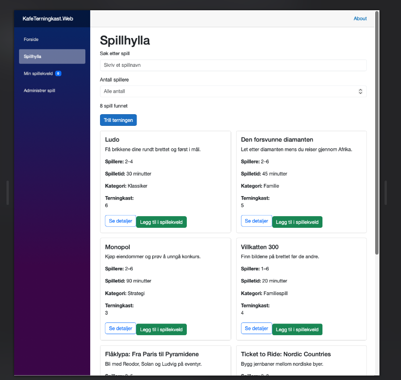

## KafeTerningkast

Dette er Blazor app for en brettspillkafe. Man kan søke etter spill, gi terningkast og planlegge spillekvelder. Man kan også administrere spillsamlingen.

## Bygg og kjør
Krever .NET 10 SDK. Kjør fra mappen med `KafeTerningkast.sln`:

```bash
dotnet restore KafeTerningkast.sln
dotnet build KafeTerningkast.sln
dotnet run --project KafeTerningkast.Web
```

Åpne adressen fra terminalen. Kjør automatiske tester med:

```bash
dotnet test KafeTerningkast.Tests/KafeTerningkast.Tests.csproj
```

APIen kjører i samme app. Endepunktene begynner med `/api/games`.

## Sider
- `/` — startside.
- `/games` — spillhylle med søk, spillerfilter og tilfeldig spillvalg.
- `/games/{Id:int}` — detaljer, terningkast og spillekveldshandlinger for ett spill.
- `/game-night` — valgte spill og samlet spilletid.
- `/admin/games` — oppretting, redigering og sletting av spill.
- `/not-found` — vises for ukjente app-ruter.

## Arkitektur og dataflyt
`App` setter opp Interactive Server. `Routes` velger side, og `MainLayout` viser siden sammen med `NavMenu`. Komponenter sender data gjennom parametere og bruker `EventCallback` for brukerhandlinger.



Når et spill legges til, sender `GameCard` det til `Games`. Siden oppdaterer `GameNightService`, som varsler menyen om nytt antall. `GameNight` leser spillekvelden fra samme tjeneste.



## Ansvar
- `NavMenu`: navigasjon og antall spill i spillekvelden.
- `Games`, `GameDetails`, `GameNight` og `AdminGames`: appens sider og brukerhandlinger.
- `GameCard`: viser et spill og sender handlinger til siden.
- `DiceRating`: terningkast fra 1 til 6, skrivebeskyttet eller interaktivt via `ValueChanged`.
- `BoardGame`: spillmodell med validering.
- `GameData`: åtte startspill.
- `GameApiClient`: samler HTTP-kall til API-et.
- `GameNightService`: scoped spillekveld, hindrer duplikater og varsler ved endringer.

## Designvalg
- **Spillekveld:** En scoped `GameNightService` deler tilstanden mellom komponentene uten å sende den gjennom alle nivåer. Hver interaktive økt får sin egen liste; faner deler den ikke.
- **Gjengivelse:** Interactive Server gir interaktivitet med C# på serveren. Det krever aktiv forbindelse og serveren holder tilstand per økt.
- **API:** `GameApiClient` samler HTTP kallene i en tjeneste. API endringer håndteres der, men dataene lagres fortsatt bare i minnet.

## Vedlikehold og begrensninger
Søk og spillerfilter ligger samlet i `Games`, og API-kallene ligger i `GameApiClient`. Et nytt spillfelt krever endringer i modell, startdata, validering, administrasjonsskjema og visninger.

- Spilldata forsvinner når serveren starter på nytt og deles mellom brukere av samme serverprosess.
- Appen har ingen database, innlogging eller tilgangskontroll for administrasjonssiden.
- Spillekvelden varer per interaktiv økt og gjenopprettes ikke i en ny økt.
- Sletting fra administrasjon fjerner ikke automatisk et allerede valgt spill fra spillekvelden; det må fjernes derfra manuelt.

## Tester
**5 automatiske tester bestått, 0 feilet**.

Testene dekker gyldig spill, tomt navn, ugyldig spillerantall, terningkast utenfor 1–6 og callback fra `GameCard`.

### Manuell testlogg
Alle 20 punktene er testet og bestått.

1. **Søk:** `ludo` og `LUDO` finner Ludo.
2. **Ingen treff:** Tommelding vises, terningknappen deaktiveres, og siden krasjer ikke.
3. **Spillerfilter:** Ludo vises for 2 og 4, ikke for 1 eller 5 spillere.
4. **Søk og filter:** Kombinasjonen gir riktige treff; listen oppdateres når søket tømmes.
5. **Terningvalg:** Ett spill markeres etter «Trill terningen».
6. **Ruter:** `/games/1` viser Ludo, `/games/9999` viser ikke-funnet, og ugyldige/ukjente ruter viser «Fant ikke siden».
7. **Lagre terningkast:** Valgt verdi beholdes etter sideoppdatering.
8. **Skrivebeskyttet terningkast:** Klikk i spillkortet endrer ikke verdien.
9. **Navigasjon:** Aktiv menyside markeres.
10. **Legge til spill:** Spill kan legges til fra både spillhylla og spillsiden; menyantallet oppdateres.
11. **Navigering:** Valgte spill beholdes når man går mellom sider i samme økt.
12. **Duplikater:** Samme spill vises bare en gang; antallet øker ikke på nytt.
13. **Spilletid og tomtilstand:** Summen stemmer; etter fjerning av alle spill vises 0 spill.
14. **To faner:** Hver fane har sin egen spillekveld.
15. **Responsiv visning:** Spillhylla fungerer ved omtrent 375 px og minst 1200 px bredde.
16. **Detaljlenke:** Ludo-kortet åpner `/games/1`; tilbakeknappen går til spillhylla.
17. **Ugyldig API-data:** Ugyldig POST og PUT gir HTTP 400.
18. **Administrasjon:** Oppretting, redigering og sletting fungerer; ugyldige felt avvises, endringer vises i spillhylla, og sletting krever bekreftelse.
19. **Sletting av valgt spill:** Det blir liggende i spillekvelden til det fjernes manuelt.
20. **Neste spill:** Lenken åpner et annet spill; ukjent spill-ID viser ikke-funnet-melding.

### Manuelle API-kall

Kontrollert med `curl`:

- `GET /api/games` og `GET /api/games/1`: HTTP 200.
- `GET /api/games/999` og `PUT /api/games/999`: HTTP 404.
- Gyldig `POST`: HTTP 201. Ugyldig `POST`: HTTP 400.
- Gyldig `PUT`: HTTP 204. Ugyldig `PUT`: HTTP 400.
- `DELETE /api/games/9`: HTTP 204; gjentatt sletting: HTTP 404.

## Skjermbilder




## Bruk av KI
KI var en støtte gjennom flere deler av arbeidskravet, fra planlegging til feilsøking og dokumentasjon. Jeg brukte samtalen som en slags arbeidslogg: Jeg beskrev hva jeg hadde gjort, viste kode eller feilmeldinger og ba om hjelp til neste konkrete steg. Jeg ba ofte om forklaringer før jeg gikk videre, slik at jeg kunne forstå hva en kodebit gjorde og hvor den hørte hjemme.

### Planlegging og Git
I starten brukte jeg KI til å dele arbeidskravet opp i mindre steg. Det gjorde det lettere å holde oversikt over hva som var ferdig, hva som manglet og hvilken funksjon som kunne bygges videre på. Jeg stilte også spørsmål om Git kommandoer. KI forklarte forskjellen mellom å legge filer til staging, lage en commit, koble til et remote repository og sende endringer til GitHub. Da autentisering med passord feilet, fikk jeg hjelp til å forstå hvordan en Personal Access Token brukes. Jeg lærte at en slik token er en hemmelighet som skal behandles som et passord, ikke legges i kildekoden eller READMEen).

### Kodeforslag og forståelse
Jeg ba KI om kodeeksempler og hjelp til å tilpasse dem til prosjektet. Det gjaldt blant annet startdata for brettspill, spillkort, terningkastkomponenten, søk og spillerfilter, spillsider, spillekveld, administrasjon og API. Jeg brukte eksemplene til å arbeide med Blazor som komponentparametere, `EventCallback`, `@bind-Value`, dependency injection og scoped tjenester.

Et konkret eksempel var terningkastkomponenten. Jeg spurte hva uttrykket `<DiceRating Value="Game.Rating" ReadOnly="true" />` betydde, hvor det skulle plasseres, og hvorfor Blazor ikke gjenkjente komponenten. Gjennom dette arbeidet lærte jeg at komponenten må ligge i et navnerom Blazor kjenner, at `Value` sender inn en verdi, og at `ReadOnly` bestemmer om brukeren kan endre den. På spillsiden brukte jeg en interaktiv variant som sender en ny verdi tilbake til forelderen. Det hjalp meg å forstå forskjellen mellom å vise data og å sende endringer mellom komponenter.

Jeg ba også om at forslag skulle ta utgangspunkt i min eksisterende kode. Da jeg delte `Games.razor` og `GameDetails.razor`, var målet å få hjelp med den aktuelle filen i stedet for et helt nytt oppsett. Jeg måtte fortsatt kontrollere at navn, ruter, mapper og parametere passet med resten av prosjektet. KI kjenner ikke automatisk hele prosjektstrukturen bare fordi den foreslår kode som ser riktig ut.

### Feilsøking og retting
Underveis viste jeg KI feilmeldinger og skjermbilder fra editoren. Vi arbeidet blant annet med Razor feil om ukjente komponenter, dupliserte attributter og feil i komponentnavnerom, samt C# feil knyttet til navnerom, medlemsnavn og Razor syntaks. Jeg lærte å bruke feilkoden og linjenummeret til å finne hvor problemet oppstod, og å skille mellom en faktisk byggefeil og en editoradvarsel.

Ikke alle forslag fra KI var riktige på første forsøk. Noen forslag passet ikke med filene mine eller skapte nye feil. For eksempel krevde Razor komponenter at navnerommet ble importert på riktig sted, og kodeblokker måtte plasseres med korrekt Razor syntaks. Da dette skjedde, måtte jeg sammenligne forslaget med feilmeldingen, rette koden og bygge på nytt. Det minnet meg på at et selvsikkert svar ikke er det samme som en fungerende løsning.

### Testing og dokumentasjon
KI hjalp meg med å forstå automatiske tester og foreslo manuelle kontrollpunkter for funksjonene i appen. Jeg kjørte selv testprosjektet; resultatet jeg fikk var fem beståtte tester og ingen feil. Jeg testet også API-et med `curl`: henting av spill, oppretting, ugyldige data, oppdatering og sletting. Jeg delte HTTP-statusene med KI for å få hjelp til å tolke dem, for eksempel at `201` betyr at en ressurs ble opprettet, `204` at en oppdatering eller sletting lyktes uten svarinnhold, og `400` eller `404` at forespørselen ble avvist eller at spillet ikke ble funnet.

For brukergrensesnittet gikk jeg gjennom 20 manuelle tester i nettleseren. De dekket blant annet søk, spillerfilter, tilfeldig spillvalg, terningkast, navigering, spillekveld, administrasjon og responsiv visning. Jeg rapporterte resultatet av hver test før den ble ført som bestått i README-en. KI hjalp med å strukturere testloggen, men resultatene bygger på det jeg selv observerte i appen og terminalen.

KI hjalp til slutt med å organisere READMEen, forklare hva som burde dokumenteres og forkorte teksten. Jeg ba om at dokumentasjonen skulle være uten tabeller, og tilpasset formatet etter det. Dermed ble README-en også en del av arbeidsprosessen: Den oppsummerer både hvordan appen er bygget opp, hvilke begrensninger den har, og hva jeg faktisk har kontrollert.

### Egen vurdering

Jeg opplevde KI som mest nyttig når jeg stilte konkrete spørsmål, for eksempel «hva betyr denne linjen?», «hvor skal denne koden inn?» eller «hva forteller denne feilmeldingen meg?». Da fikk jeg forklaringer jeg kunne bruke videre, og jeg kunne be om et nytt forslag hvis svaret var uklart. Når jeg bare kopierte en stor kodeblokk uten å forstå den, ble det vanskeligere å finne feil og tilpasse løsningen.

Arbeidet lærte meg å bruke KI som et hjelpemiddel, ikke som fasit. Jeg måtte selv lime inn og tilpasse kode, starte appen, lese feilmeldinger, kjøre testene, prøve API kall og kontrollere sidene i nettleseren. Jeg lærte særlig mer om hvordan data og hendelser flyter mellom Blazor komponenter, hvordan en tjeneste kan dele tilstand i en interaktiv økt, og hvordan APIen validerer forespørsler. Jeg er ansvarlig for koden jeg leverer, også der jeg har brukt KI til å komme fram til den.
